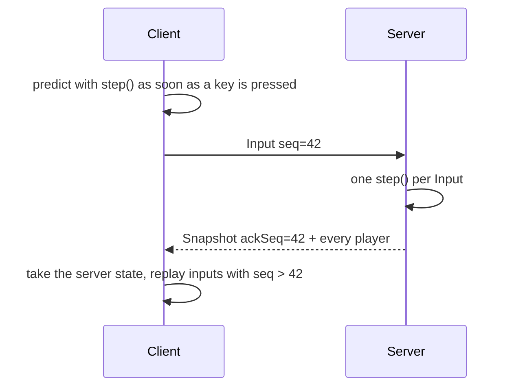

# sidescroll-net

[中文](README.md)

An authoritative server for a 2D side-scrolling multiplayer game. The server runs the physics, each client predicts its own player and interpolates everyone else, so it still feels responsive at 300 ms of lag.

Terrain is made of footholds: one-way platform segments that can slope, can be jumped through from below, and can be dropped through with down + jump. Many 2D online games work this way, and it handles slopes and stacked platforms better than a tile grid.



## Quick start

Requires Node.js 20 or later.

```sh
git clone https://github.com/vtxe02023274/sidescroll-net.git
cd sidescroll-net
npm install
npm run dev
```

Open http://localhost:8080 and a second tab to see another player. The controls under the canvas change the simulated lag and turn prediction or interpolation off so you can compare.

| Key        | Action                  |
| ---------- | ----------------------- |
| ← → or A D | Move                    |
| Space      | Jump                    |
| ↓ + Space  | Drop through a platform |

## How it works

**One physics function.** `step(map, state, buttons)` in `src/shared/physics.ts` runs on both sides at a fixed 30 ticks, with no clocks and no randomness. State is rounded to f32 after every step, the same precision snapshots use, so a client replaying from a snapshot lands exactly where the server did. The tests run 600 ticks with 6 ticks of latency and expect a correction of zero.

**The server only trusts input.** Clients send buttons, never positions. Each input moves the player one step, the queue holds at most 8 and on average one is spent per tick, so flooding inputs does not make anyone faster.

**Small snapshots.** Sent every other tick, 24 bytes per player, plus the last input sequence the server applied for that client.

**Interpolation for others.** Remote players are drawn 100 ms in the past, between the two snapshots around that time, so jitter does not make them jump.

The wire format is documented at the top of `src/shared/protocol.ts`.

## Drawing maps in Tiled

Add an object layer called `footholds` and draw platforms with polylines. Each segment becomes a foothold and the segments of one polyline are linked. Add a point named or classed `spawn` for the spawn point. Save as JSON (.tmj) and convert:

```sh
npm run build
npm run tiled2map -- my-map.tmj -o maps/my-map.json
MAP=maps/my-map.json npm start
```

Vertical segments are skipped, and polylines can be drawn in either direction. There is an example in `test/fixtures/hills.tmj`.

## Layout

```
src/shared   physics, map and packets (used by both sides)
src/server   Game state and the WebSocket server
src/client   prediction, interpolation and rendering
src/tools    Tiled map converter
maps         map JSON
test         physics and netcode tests
```

`Game` does not touch sockets and can be stepped tick by tick in tests. Swapping in UDP or another transport only touches `src/server/main.ts`.

## Load testing

```sh
npm run build
npm start
npm run bots -- -n 200 -t 30   # in another terminal
```

The server prints player count, tick time and bandwidth every 10 seconds. With 200 bots on one map a tick takes about 2 ms on average, but every snapshot carries every player, so bandwidth grows with n² and sits around 12 MiB/s.

## Development

```sh
npm test
npm run lint      # eslint + prettier
npm run typecheck
```

## License

MIT
