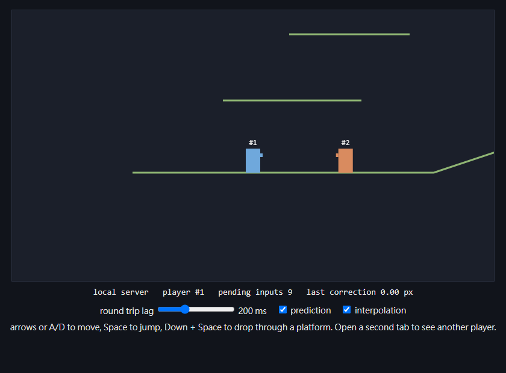
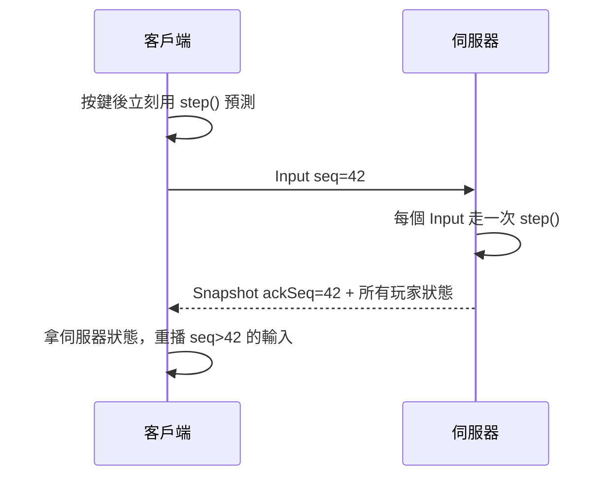

# sidescroll-net

[English](README.en.md)

橫向捲軸多人遊戲的權威伺服器範例：伺服器跑物理、客戶端預測自己、內插別人，延遲 300 ms 操作起來還是跟手。

地形用「踏板」（foothold）描述：一段一段的單向平台線段，可以有斜坡，可以從下面跳上去，按下＋跳可以往下穿。很多 2D 線上遊戲都是這種做法，比格子地圖更適合斜坡和多層平台。

線上試玩（伺服器跑在瀏覽器裡，另外有 3 個機器人）：https://vtxe02023274.github.io/sidescroll-net/





## 快速開始

需要 Node.js 20 以上。

```sh
git clone https://github.com/vtxe02023274/sidescroll-net.git
cd sidescroll-net
npm install
npm run dev
```

開 http://localhost:8080 ，再開第二個分頁就能看到另一個玩家。畫面下方可以調延遲、關掉預測或內插，直接比較差別。

| 按鍵       | 動作         |
| ---------- | ------------ |
| ← → 或 A D | 移動         |
| Space      | 跳           |
| ↓ + Space  | 從平台往下穿 |

## 做法

**同一份物理**：`src/shared/physics.ts` 的 `step(map, state, buttons)` 伺服器和客戶端共用，固定 30 tick、不讀時間也不用亂數。狀態每步都轉成 f32，跟快照的精度一樣，所以客戶端從快照重播會跟伺服器算出完全相同的位置。測試在 6 tick 延遲下跑 600 tick，修正量是 0。

**伺服器只信輸入**：客戶端送的是按鍵，不是座標。一個輸入只走一步，佇列最多存 8 個、每 tick 平均只消耗 1 個，連發輸入也跑不快。

**快照省頻寬**：每 2 tick 送一次，每個玩家 24 bytes，帶上這個客戶端最後被處理的輸入序號。

**別人用內插**：其他玩家畫在 100 ms 之前，取前後兩張快照中間的位置，網路抖動也不會跳。

封包格式寫在 `src/shared/protocol.ts` 開頭的註解。

## 用 Tiled 畫地圖

在 Tiled 開一個物件圖層叫 `footholds`，用折線（polyline）畫平台，每一段會變成一個踏板，同一條折線的各段自動相連。放一個名稱或類別叫 `spawn` 的點當出生點。存成 JSON（.tmj）後轉檔：

```sh
npm run build
npm run tiled2map -- my-map.tmj -o maps/my-map.json
MAP=maps/my-map.json npm start
```

垂直的線段會略過，左畫到右或右畫到左都可以。範例在 `test/fixtures/hills.tmj`。

## 專案結構

```
src/shared   物理、地圖、封包（兩邊共用）
src/server   Game 狀態與 WebSocket 伺服器
src/client   預測、內插與畫面
src/tools    Tiled 地圖轉檔
maps         地圖 JSON
test         物理與網路同步測試
```

`Game` 不碰 socket，可以在測試裡一個 tick 一個 tick 推進；想換成 UDP 或別的傳輸層只要改 `src/server/main.ts`。

## 壓力測試

```sh
npm run build
npm start
npm run bots -- -n 200 -t 30   # 另一個終端機
```

伺服器每 10 秒印一次人數、tick 耗時和流量。機器人會先往右走一段再到處晃，分散在地圖上。

預設每個快照帶全部玩家，流量是 O(n²)。設 `VIEW=寬x高`（半徑，像素）只送附近的玩家：

```sh
MAP=maps/long.json VIEW=600x450 npm start
```

| 6000 px 地圖、200 個機器人 | tick 平均 | 流量       |
| -------------------------- | --------- | ---------- |
| 不限視野                   | 2.5 ms    | 13.8 MiB/s |
| `VIEW=600x450`             | 3.1 ms    | 6.1 MiB/s  |

有視野限制時每個玩家要各編碼一次快照，所以 tick 稍微變重；不限視野時只編碼一次再改 ack。

## 開發

```sh
npm test          # 單元測試
npm run lint      # eslint + prettier
npm run typecheck
```

## 授權

MIT
